# HOPPA · 同城轻社交与活动组队

> **线上相遇，线下来聚。**

面向年轻人的同城活动发现与组队产品：围绕 City Walk、展览、桌游、运动、美食、演出这些**具体活动**，
把「想一起做点什么的人」从线上匹配带到线下见面，再留下一张旅行名片。

这是一个**可交互、可重复演示的产品作品集 MVP**：React 19 + TypeScript + Vite 6，
数据全部在浏览器本地模拟，不接真实定位、支付、短信、报警或任何第三方服务。

**[在线演示](https://lier128.github.io/hoppa/)** · [产品文档](docs/product/) · [决策记录](docs/decisions.md) · [验收记录](docs/acceptance.md) · [作品集叙事](docs/portfolio-story.md)

---

## 这是什么 / 为什么值得看

不是又一个社交 App 界面稿。这个项目完整走了一遍「产品决策 → 规格 → 实现 → 验证」的链路：

| 环节 | 交付物 |
|---|---|
| 产品定义 | PRD：定位、用户与 JTBD、P0/P1/P2 范围、北极星指标与漏斗口径、安全边界 |
| 交互规格 | 13 个页面的状态、异常分支与三段演示脚本（参与者 / 组织者 / 安全边界） |
| 实现 | 15 个路由页面、6 类活动、15 条武汉 seed 活动、6 个可切换演示身份 |
| 规则 | 申请 / 容量 / 状态机 / 评价 / 签到 / 退出等规则集中在纯函数层，47 个单元测试覆盖 |
| 验证 | 17 个 Playwright 端到端用例（桌面 13 + 移动 4），真实浏览器跑通主闭环 |
| 边界 | 明确的演示边界：不拨号、不定位、不支付、不伪造「匹配成功」或「下载成功」 |

**面试时最有信息量的三个取舍**（详见 [docs/decisions.md](docs/decisions.md)）：

1. 不做 3D 城市元宇宙，先把「发现 → 申请 → 参加 → 评价」闭环跑通；
2. 不用 MBTI 决定匹配，用活动类型 / 时间 / 预算 / 出行方式做**可解释**推荐；
3. 不照搬原型截图里的照片素材（无可授权来源），改为「品类渐变 + 品牌拼图 + 品类图标」的生成式封面。

## 快速开始

```bash
# Node 22+（本项目在 Node 22.11 上验证；Vite 6 是刻意选择，Vite 8 需要 Node >= 22.12）
npm install
npm run dev          # http://localhost:5173
npm run build        # 生产构建 → dist/
npm run preview      # 预览生产构建 → http://localhost:4173
npm test             # 单元测试（Vitest，47 个）
npm run test:e2e     # 端到端测试（Playwright，使用本机 Chrome）
npm run qa           # typecheck + 单元测试 + 生产构建
```

> 构建脚本 `scripts/build.mjs` 会把 esbuild 临时目录指到项目内 `.tmp`：
> 本机 `%TEMP%` 下 esbuild 清理临时文件会被系统拒绝（`Access is denied`），这是环境问题而不是代码问题。
> 如果你在自己的机器上遇到同样报错，这个包装器已经处理；CI（Ubuntu）不受影响。

首次打开会出现演示入口：可选**参与者**或**组织者**身份进入。右下角「演示工具」可随时切换 6 个演示身份、
查看本地埋点数量、重置演示数据。

## 三段演示脚本（每段 1–3 分钟）

**A. 参与者完整闭环**（默认身份：林小满）

1. 首页 → 搜索「东湖」或点「City Walk」品类 → 打开活动详情；
2. 「申请加入」→ 填写留言 → 二次确认时间/地点/费用 → 提交；
3. 切到演示工具换成组织者「陈屿」，进入 `/manage/a_donghu_sunset` 通过申请；
4. 切回林小满 → `/my` → 进行中的活动「模拟签到」；
5. 组织者「结束活动」→ 参与者提交评价 → 生成旅行名片 → 复制分享文案。

**B. 组织者从 0 到 1**

1. `/create` 填写一场活动（校验会拦过去时间、人数越界、介绍过短）；
2. 发布后进入详情，右栏出现「管理活动」；
3. `/manage/:id` 审核待审申请（满员会拦）、查看成员与签到状态；
4. 开始活动 → 结束活动 → 去评价 → 旅行名片。

**C. 安全边界（30 秒）**

1. 进行中活动 →「安全中心」；
2. 顶部明确标注「演示功能，不构成真实安全保障」；
3. 点「演示求助」→ 确认框写明**不会拨打电话、不会获取定位、不会向任何第三方发送数据**；
4. 举报 → 提交后显示「已记录（演示）」。

## 功能范围

### P0（已实现）

| 模块 | 实现要点 |
|---|---|
| 首页 / 发现 | 搜索、品类入口、类型/时间/预算/出行方式组合筛选、空状态一键清除、精选路线卡 |
| 同城内容 | 6 条城市内容流，点赞/收藏可撤销且本地持久化，关联活动跳转 |
| 找搭子 | 社群/个人切换、偏好匹配面板、真实重排、透明推荐原因、0 结果给出可执行建议 |
| 活动详情 | 时间/地点/费用/人数/组织者/路线/参与者、按身份与状态给出唯一正确主操作 |
| 加入申请 | 留言 → 二次确认 → 提交；满员/取消/结束/已开始/重复申请均被拦截并说明原因 |
| 我的活动 | 准备中 / 进行中 / 待评价 / 已结束 / 我发起的，五类操作与状态严格对应 |
| 活动管理 | 申请通过/拒绝（容量校验）、成员与签到状态、开始/结束/取消、修改集合地点（写入群聊通知） |
| 消息 / 群聊 | 会话列表、气泡、Enter 发送、Shift+Enter 换行、刷新保留、非成员禁言 |
| 活动闭环 | 模拟签到、结束活动、评价（仅结束后、每人一次）、旅行名片复制分享 |
| 个人中心 | 资料编辑（昵称/简介/兴趣标签/偏好）全局同步、统计卡、快捷入口 |
| 安全中心 | 活动摘要、6 条安全建议、复制信息、举报（本地模拟）、退出活动、演示紧急求助 |
| 本地持久化 | localStorage 单一出入口，`schemaVersion` 变更自动重建 |

### P1（部分实现）

- ✅ 旅行名片（含路线节点、评分、品牌页脚，复制分享文案与埋点）
- ✅ 同城内容流的点赞 / 收藏
- ✅ 透明推荐理由（类型 / 周末 / 预算 / 出行方式）
- ⛔ 未做：活动分享链接、生成图片、搜索历史、评论

### P2（明确不做，并写进产品边界）

3D 城市元宇宙、真实定位与后台追踪、真实报警、实名/年龄核验、短信推送、真实支付、生产级即时通讯、
真实地图导航、复杂推荐算法、多城市运营后台。

## 页面一览

| 首页 / 发现 | 活动详情 |
|---|---|
| 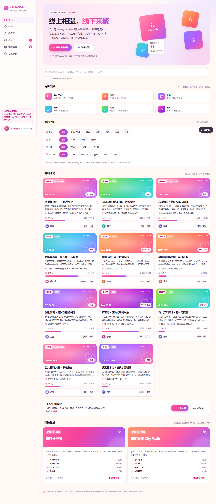 | 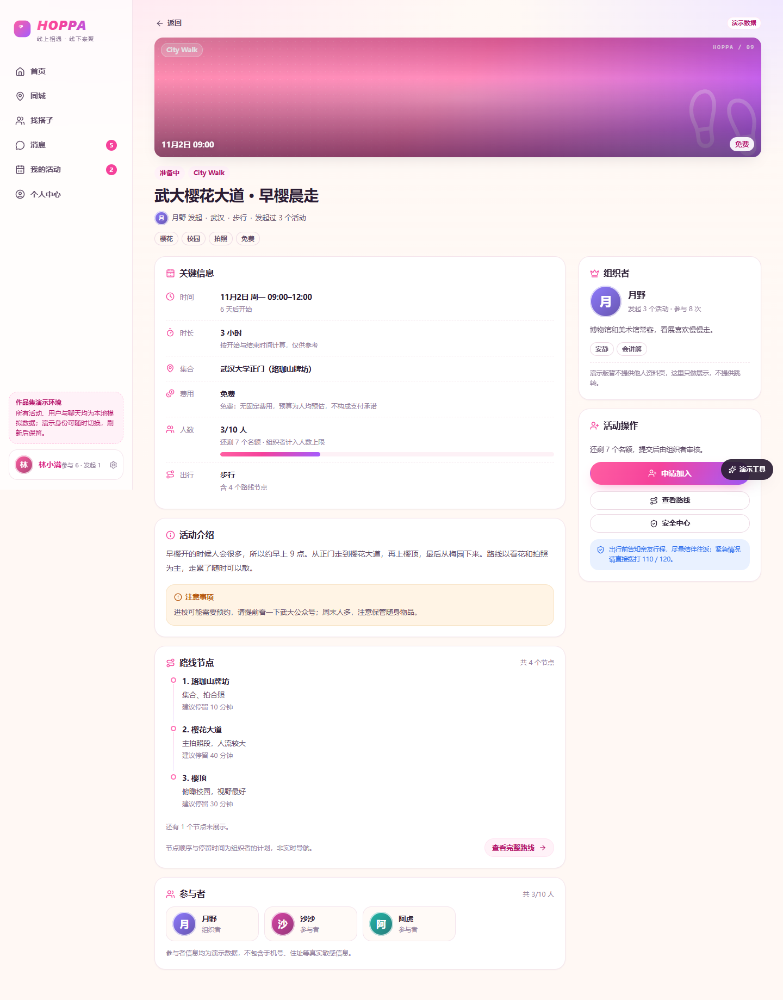 |

| 找搭子（透明推荐） | 活动管理（组织者） |
|---|---|
| 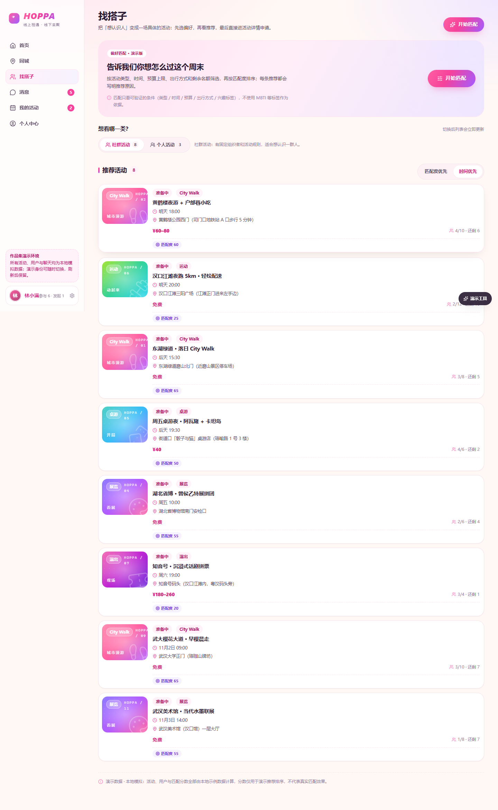 | 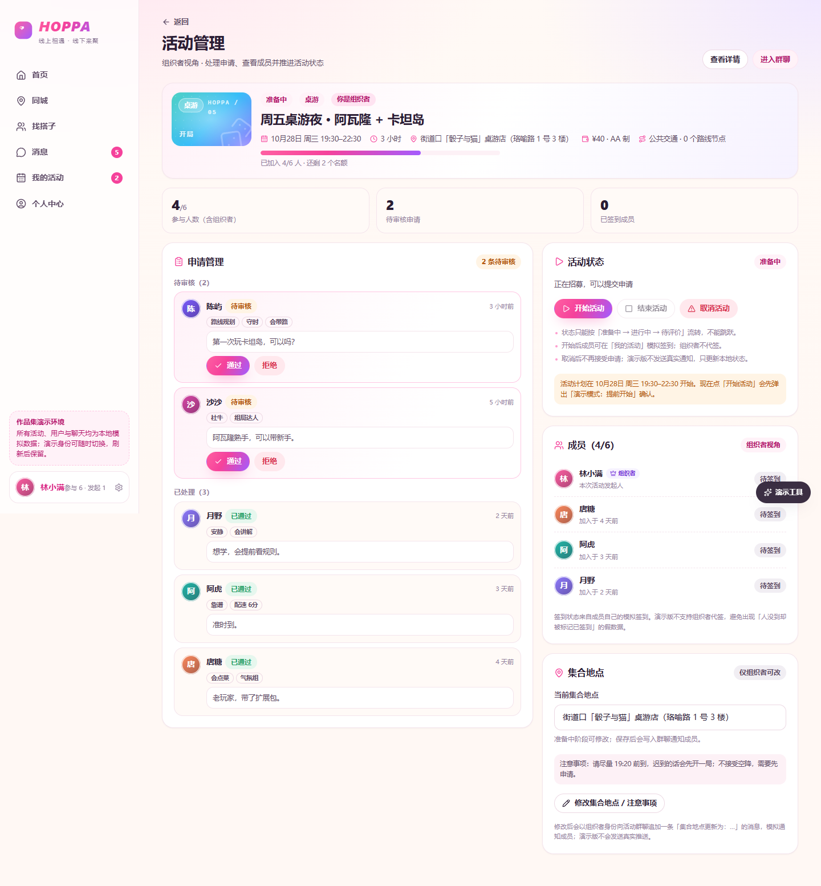 |

| 群聊（本地模拟） | 旅行名片 |
|---|---|
|  | 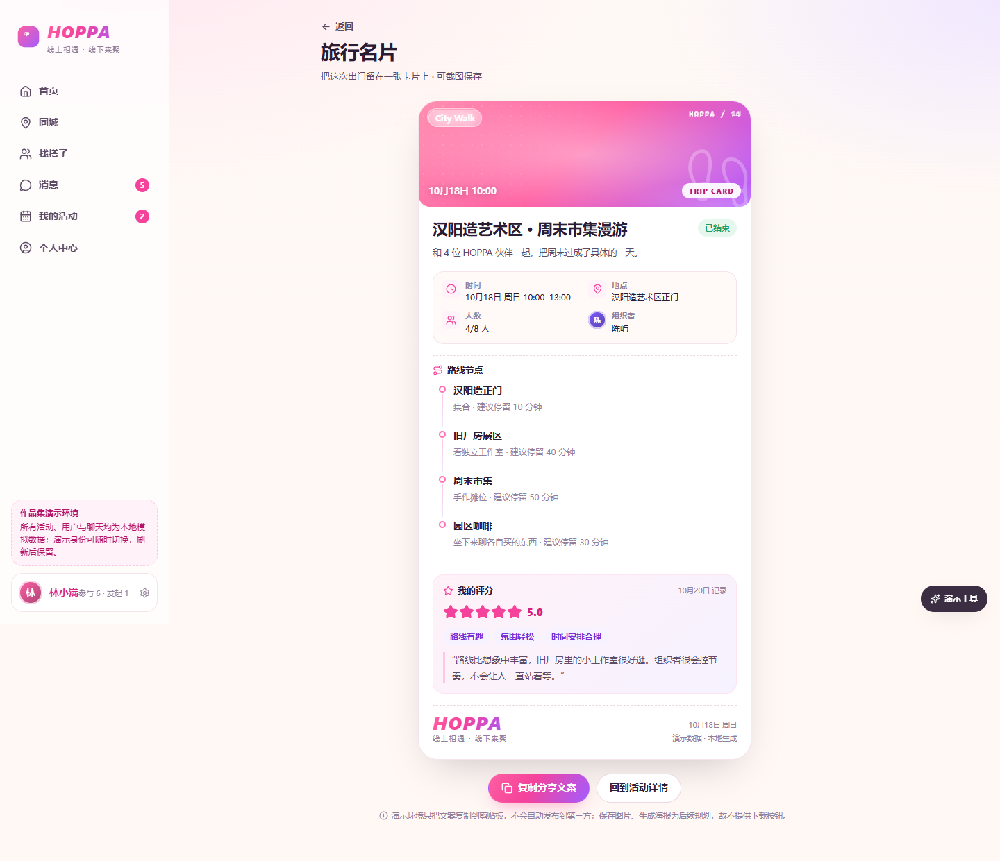 |

| 创建活动（实时预览 + 校验） | 我的活动（状态与操作对应） |
|---|---|
| 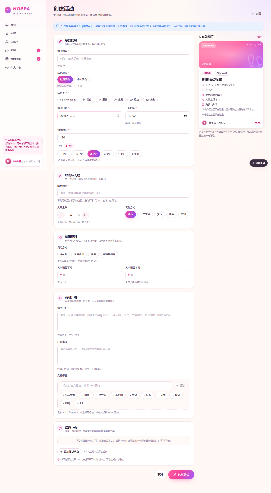 | 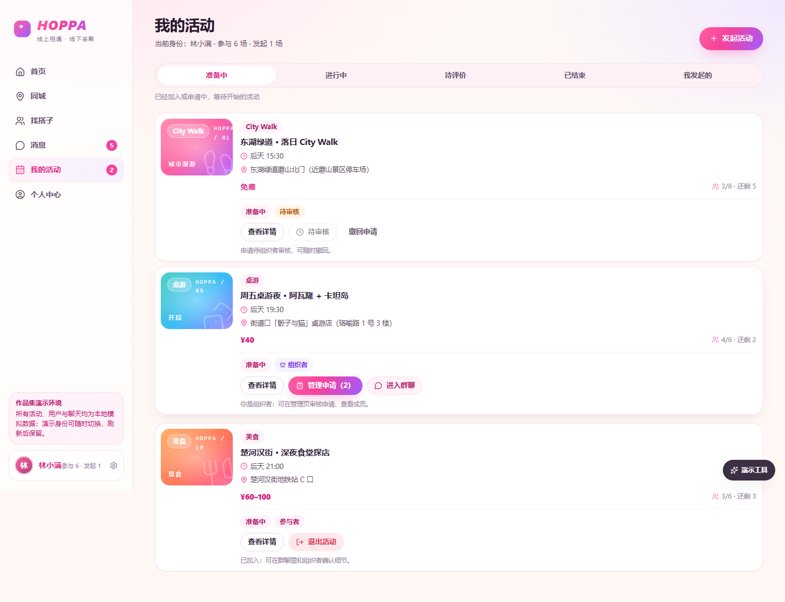 |

移动端（390px）：

| 首页 | 详情 | 找搭子 | 旅行名片 |
|---|---|---|---|
| 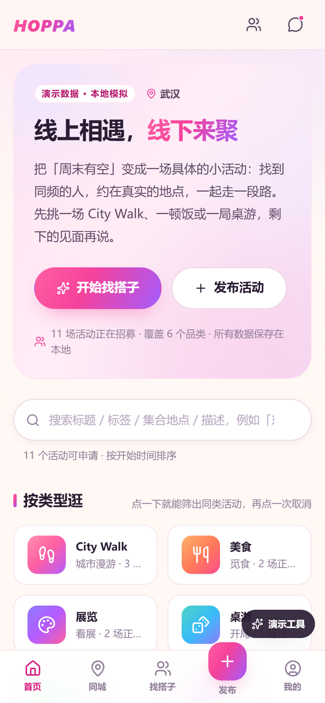 | 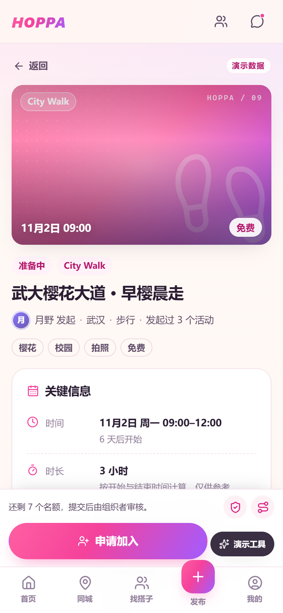 | 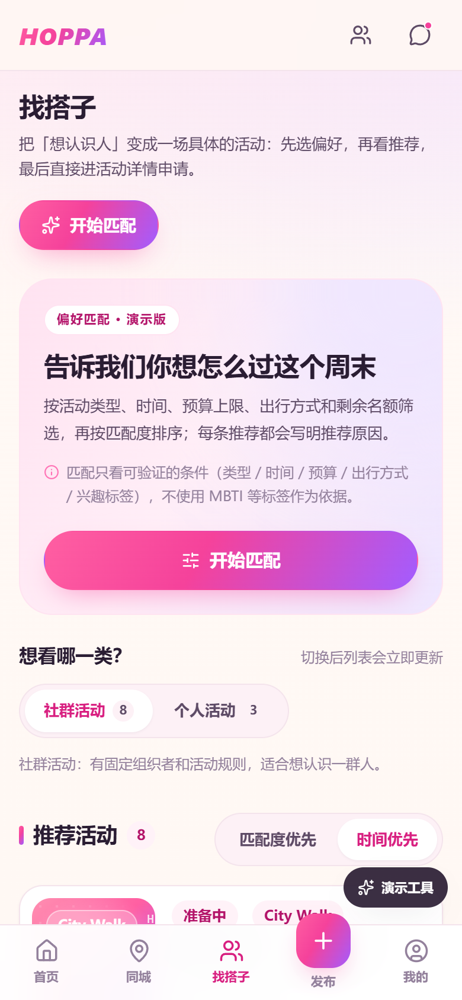 | 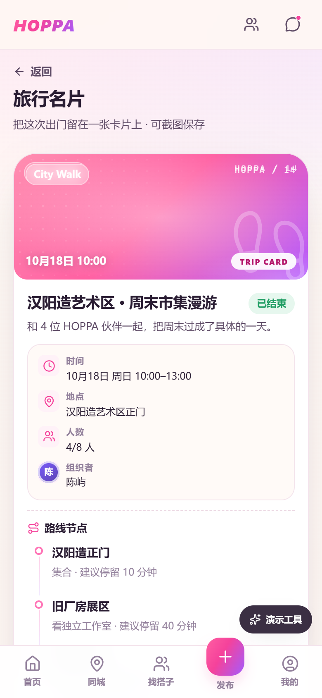 |

## 技术架构

```
src/
├── types.ts                 # 实体、状态枚举、文案元数据（唯一来源）
├── data/seed.ts             # 15 条武汉活动 + 6 个演示用户 + 申请/群聊/评价/内容流
├── domain/
│   ├── rules.ts             # 业务规则纯函数（能否申请/审核/评价/签到/修改…）
│   └── recommend.ts         # 透明推荐理由与打分
├── store/
│   ├── AppStore.tsx         # useApp()：查询 + 操作（页面唯一数据入口）
│   ├── reducer.ts           # 纯 reducer，全部状态流转
│   └── persistence.ts       # localStorage 唯一出入口
├── components/              # UI 原子组件、布局外壳、活动卡
├── pages/                   # 15 个路由页面（各自 CSS Module）
└── styles/                  # 设计令牌 + 全局样式
```

数据流：`页面 → useApp() → domain/rules（判断）→ reducer（流转）→ persistence（落盘）`。
页面**不直接读写 localStorage**，也不散落状态判断——「能不能申请」「能不能评价」只有一处定义。

设计系统见 `src/styles/tokens.css`：粉紫渐变主色、暖白/浅桃背景、14–20px 圆角、生成式活动封面；
所有页面样式通过 CSS Modules + 设计令牌实现，没有引入 UI 组件库。

## 业务规则

| 规则 | 行为 |
|---|---|
| 发起者自动成为组织者 | 创建时写入 organizer 成员，不占用申请流程 |
| 已通过人数 ≤ 人数上限 | 审核通过前校验，满员直接拒绝并提示 |
| 满员 / 已取消 / 已结束 / 已开始不可申请 | 按原因返回具体文案，按钮禁用 |
| 同一用户不能重复申请 | 有效申请（pending/approved）唯一 |
| 活动时间必须在未来 | 表单即时提示 + 提交拦截 |
| 仅结束后可评价，每人一次 | 状态与唯一性双重校验 |
| 状态不允许跳跃 | 准备中 → 进行中 → 待评价 → 已结束；取消独立 |
| 组织者不能退出自己的活动 | 提示去「活动管理」取消 |
| 签到仅进行中、仅成员、仅一次 | 幂等写入 |
| 举报只写本地模拟数据 | 状态 `recorded`，页面显示「已记录（演示）」 |

## 测试与验收

最近一次完整验证（2026-10-26，本机 Windows / Node 22.11 / Chrome）：

```text
npm run typecheck   → 0 error
npm test            → 3 test files, 47 tests passed
npm run build       → ✓ built（index 459.73 kB / gzip 140.43 kB；vendor 已拆分）
npm run test:e2e    → 17 passed（desktop 13 + mobile 4）
```

- 单元测试覆盖：申请资格与容量、状态机、评价唯一性、签到幂等、退出规则、表单校验、reducer 状态流转、埋点上限、日期工具。
- E2E 覆盖：演示入口、搜索与品类筛选、找搭子匹配、申请→审核、创建活动与刷新持久化、状态推进与评价闭环、
  群聊持久化、安全边界（不拨号/不定位）、模拟举报、重置演示数据、375px 无横向溢出。
- 逐条验收对照见 [docs/acceptance.md](docs/acceptance.md)；**尚未执行**真实用户可用性测试，计划见 [docs/user-testing-plan.md](docs/user-testing-plan.md)。

## 已知限制

1. 无后端与账号体系：刷新保留依赖浏览器 localStorage，换浏览器/清缓存会回到初始演示数据。
2. 组织者修改集合地点只在「准备中」可用；真实产品需要推送通知，演示版以群聊消息模拟。
3. 群聊是本地模拟：无实时通讯、无未读数、无已读回执、无多端同步。
4. 分享只支持复制文案，没有生成图片或可传播链接。
5. 未接真实地图：路线为静态示意图 + 结构化节点，明确标注「非实时导航」。
6. 未在真机 iOS/Android 验证，移动端以 Chrome 375/390px 视口验证。
7. 用户研究与可用性测试未执行；PRD 中的用户问题与假设仍需验证。

## 更新仓库（本机网络环境的备用通道）

本机 `github.com:443` 被网络阻断（`api.github.com` 正常），`git push` 会超时。
仓库里的 `scripts/push-to-github.mjs` 用 Git Data API 完成推送，效果与 `git push` 等价：

```powershell
$env:GH_TOKEN = "<token>"       # 需要 repo + workflow 权限
node scripts/push-to-github.mjs "feat: 更新说明"
```

在网络正常的环境里直接 `git push origin main` 即可。

## 文档索引
| 文档 | 内容 |
|---|---|
| [docs/product/HOPPA_PRD_v1.0.md](docs/product/HOPPA_PRD_v1.0.md) | 产品需求文档（定位、范围、指标、数据模型、验收标准） |
| [docs/product/HOPPA_交互与页面规格_v1.0.md](docs/product/HOPPA_交互与页面规格_v1.0.md) | 页面级交互、状态与演示脚本 |
| [docs/product/HOPPA_功能验收与数据埋点.xlsx](docs/product/HOPPA_功能验收与数据埋点.xlsx) | 需求清单 / 事件埋点 / 测试用例 / 指标口径 |
| [docs/decisions.md](docs/decisions.md) | 产品与技术决策记录（为什么这样做、为什么不那样做） |
| [docs/acceptance.md](docs/acceptance.md) | 逐条验收结果与证据 |
| [docs/portfolio-story.md](docs/portfolio-story.md) | 作品集叙事结构、简历描述与面试问答 |
| [docs/user-testing-plan.md](docs/user-testing-plan.md) | 3–5 人可用性测试计划（待执行） |

> 原始移动端原型截图（含第三方素材）只保留在本地，未公开在仓库中，避免图片版权风险；
> 本仓库所有界面均为用代码重新实现的版本。

## 关于这个项目

- 产品概念、原始移动端原型与 PRD 方向来自本人既有方案；本仓库的 MVP 范围收敛、交互规格、数据模型与实现为本次作品集重构。
- 代码为 AI 辅助开发（Vibe Coding），由本人定义范围、规则、验收标准并逐项验证；**未执行的测试没有写进结论**。
- 所有活动、用户、评价、聊天与统计数字均为虚构演示数据，不代表真实运营结果。
- 演示环境不采集手机号、身份证、精确位置；不拨打真实电话；不接入支付；不向第三方发送数据。
